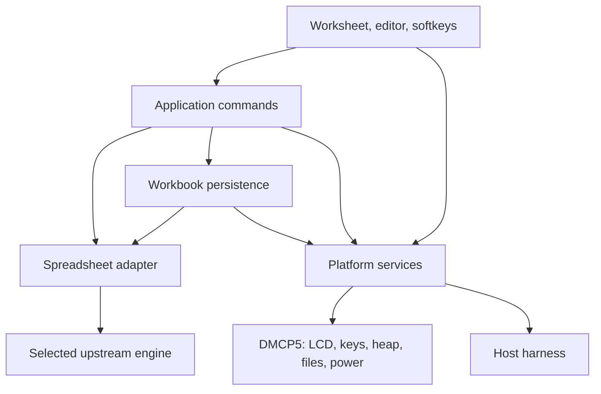

# Architecture direction

Research baseline: 2026-11-12. These are design proposals, not implemented APIs
or measured product limits.

## Required user experience

Sheets47 is a graphical spreadsheet. The normal workspace must show cells in a
familiar grid with column letters, row numbers, an active cell, range selection,
formula/value editing, and scrolling. The DM32/DM42n screen is the principal
workspace; softkeys and keypad actions operate on the visible worksheet.

This product requirement comes before engine preference. “Headless” refers only
to a reusable calculation backend. The selected backend must support the grid's
editing and reference behavior and leave adequate memory for its interface.
The application supplies the graphical worksheet, adapting selected existing
UI code where useful and compatible. No candidate's desktop or terminal UI has
been qualified for direct reuse on DMCP5.

Review worksheet, editor, and range-selection screen designs and their key flows
alongside engine feasibility, before committing to an engine. Use familiar
spreadsheet interaction as the product model and native DMCP drawing/menu
conventions as platform references.

See the [400 × 240 worksheet and range-selection concepts](design/README.md)
for original graphical drawings informed by the inspected Chess47/Nav47
screenshots. Their native black-and-white previews illustrate actual cell
borders, inverted headings, selection frames, and softkeys at display resolution.
They are design artifacts with a substitute font, not running calculator output.

## Platform and application model

Deliver a standalone `SHEETS47.pg5` for DMCP5. DM42n and DM32 are the intended
hardware targets; C47/R47 describe calculator software and associated key
layouts. Loading Sheets47 replaces the active calculator program until that
program is loaded again. Do not assume access to C47's engine, registers, fonts,
or state while Sheets47 is running. Original DM42 `.pgm` support is outside the
initial scope.

Use one portable spreadsheet backend behind a small project-owned adapter.
The adapter should expose cell values/formulas, errors, range operations,
structural edits, recalculation, and access for persistence. The backend should
own cell storage and formula semantics; avoid duplicating a workbook model just
to draw it. Project metadata can hold viewport, formats, and editor state that
the engine does not represent.

The diagram shows alternative platform implementations. A host build must use
the same engine and command semantics as the calculator, so numerical and
editing tests transfer directly.

## Display and input

The examined DMCP5 header defines a **400 × 240**, one-bit display with a
**32-pixel** menu area. Preserve the six-key bar in the normal worksheet view;
the remaining 208 pixels accommodate status, formula/value preview, column
headings, and the grid. Render only the visible cells. Use an outlined or
inverted active cell, row numbers, column letters, and horizontal/vertical
scroll indicators. Show the full selected-cell value or formula in an editor
instead of shrinking every grid entry.

Initial menu proposal:

| Page | F1 | F2 | F3 | F4 | F5 | F6 |
| --- | --- | --- | --- | --- | --- | --- |
| Worksheet | EDIT | RANGE | FORM | FORMAT | FILE | >> |
| Range | COPY | PASTE | FILL | INSERT | CLEAR | BACK |

Use logical actions independent of physical key numbers: move, edit, commit,
cancel, backspace, shift, alpha, and softkey. DM32/DM42n keymap behavior must be
verified separately, including C47/R47 overlays. A numeric-key navigation mode
must be distinct from editing so typing a digit cannot unexpectedly move the
cursor. An A1 cell-reference picker and function menu can reduce alpha typing.
The worksheet notation remains provisional until the selected engine's
reference/copy semantics are established; mtCellEdit's R1C1 model would need an
explicit presentation decision.

Use SDK drawing/font services first. Treat Nav47/C47 fonts as separately
licensed assets if later adopted. Do not add a new desktop GUI toolkit.

## Memory and execution

The official DMCP5 linker script declares application sections at:

| Region | Origin | Declared capacity |
| --- | --- | --- |
| Program flash | `0x080a0000` | 1024 KiB |
| Static RAM | `0x28000000` | 8 KiB |
| QSPI | `0x90000000` | 2048 KiB |

These are SDK link-region declarations, not a promise that every byte is free
on every device. QSPI contents are a separately managed dependency; avoid needing
to replace them for the first application.

Large worksheet state must live on the DMCP-managed heap. Use
`sys_free_mem()` and `sys_largest_free_mem()` to measure availability, then set
conservative limits with room for menus, file buffers, editor state, stack, and
recalculation temporaries. A large reported total heap does not imply a large
contiguous allocation will succeed. The SDK wraps allocation calls and discards
normal C/math library sections; audit the engine's actual link requirements,
especially C++ allocation, exception handling, strings, and math symbols.

Prefer sparse storage, but measure its overhead for both clustered and widely
separated populated cells. Bound expression length, nesting, dependency work,
undo/clipboard storage, and imports. Do not promise a maximum sheet dimension
or populated-cell count before measurements. Start with a single user-facing
worksheet if that reduces integration work; additional sheets are a later
feature even if the engine supports them.

Binary64 is the provisional numerical baseline. Do not equate it with C47's
decimal or extended-precision arithmetic. Retain upstream error and reference
semantics and document differences from Excel. Establish that a failed edit
preserves a usable workbook; catching an allocation error alone does not prove
that guarantee.

Avoid continuous redraw or busy polling. Cooperate with sleep, auto-off, power
flags, and USB power changes. Long recalculations must have a measured bound or
cooperative cancellation; establish this during engine qualification before
committing to an expensive function set.

## Persistence

Plan for a project-specific calculator directory such as `/SHEETS47`, short
filenames, and a versioned workbook format that preserves formulas and formats.
CSV/TSV are interchange formats, not sufficient native workbook formats.

Use a storage adapter rather than assuming POSIX files or a complete desktop
filesystem API. Evaluate the selected SDK's write, close, rename, directory,
and USB-disk handoff behavior. Design recoverable saves around the guarantees
actually available: keep a last-good generation, validate a new generation,
and update a small selection record where practical. Do not promise an atomic
rename or power-loss-safe save without target evidence.

Do not write to flash after each cursor movement. Save on explicit request and
controlled checkpoints; distinguish pending edits from committed workbook state.
USB disk ownership changes must close files and stop writes. Persisted recovery
generations need a deliberate retention policy; deleting any existing files
during development requires the user's approval.

## Evidence

- [Official DMCP5 linker script](https://github.com/swissmicros/DMCP5_SDK/blob/master/stm32_program.ld)
- [Official DMCP5 build configuration](https://github.com/swissmicros/DMCP5_SDK/blob/master/Makefile)
- [DMCP development manual](https://technical.swissmicros.com/dmcp/devel/dmcp_devel_manual/)
- [Local reference findings and fingerprint manifest](research/brainbox.md)
