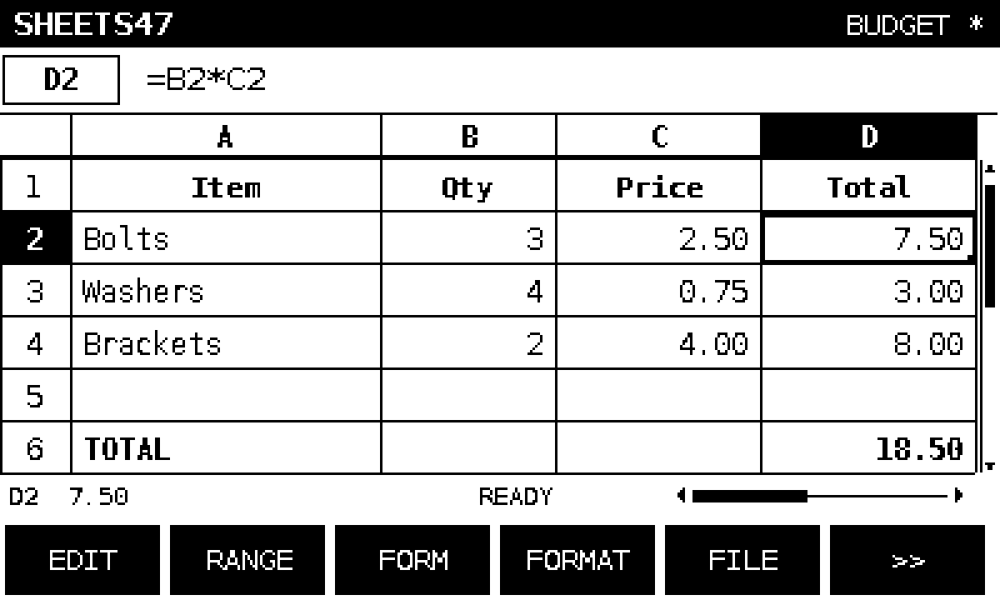
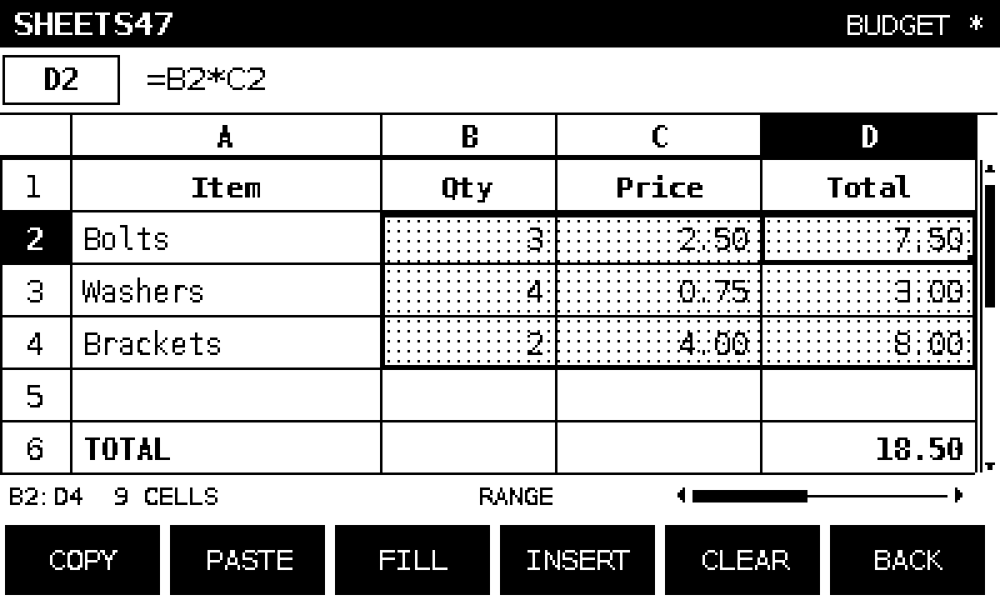

# Worksheet visual concepts

Original design drawings, 13 November 2026. These show the proposed graphical
spreadsheet at the DMCP5 display's 400 × 240 pixel dimensions. They are design
artifacts, not calculator screenshots, a running UI, or measured hardware output.

## Worksheet

The worksheet has a filled title bar, separate cell-address/formula strip,
lettered column headers, numbered row headers, ruled cells, an outlined active
cell with a corner handle, scroll indicators, and six filled softkey buttons.
The sample selected cell D2 contains `=B2*C2` and displays 7.50. The asterisk
marks unsaved work. Typeface and row density are proposals for review.

## Range selection

The B2:D4 range has a surrounding border and sparse dot pattern; the active
cell remains outlined. The softkeys change to range operations. Whether this
pattern remains legible on the physical LCD requires a target review.

## What informed these drawings

Inspected read-only references in `/home/jacober/Projects/Brainbox`:

- `nav47.pg5-main/docs/views1.png`: tabular Almanac view, compact alignment,
  heading rules, and six black softkey buttons.
- `nav47.pg5-main/docs/views2.png`: Route view with column headings, inverse
  selections, and contextual softkeys; Tide view with divided graphical panes.
- `nav47.pg5-main/docs/views3.png`: inverse field labels and structured editing.
- `chess47.pg5-main/docs/screens.png`: rendered grid graphics, patterned fills,
  selection borders, and text/graphics sharing the display.

Nav47's README identifies its pictures as simulator output and notes that the
menu font is a substitute for the DMCP font. Its description of C47-derived
16-pixel text rows is evidence about Nav47's chosen layout, not a Sheets47 font
or capacity guarantee. The concepts use an installed system font as a stand-in.

These are visual references. No screenshot pixels, reference source code,
upstream fonts, or other assets have been copied into these drawings. Exact
upstream font reuse would need a separate provenance and licensing decision.
The pale display tint in the reference pictures is not a grayscale capability;
these concepts use strictly black and white pixels.

## Files and reproduction

- `worksheet-concept.svg`, `range-concept.svg`: vector drawing sources.
- `worksheet-concept.png`, `range-concept.png`: native 400 × 240 raster previews.
- Files ending in `-3x.png`: nearest-neighbor enlargement to show native pixels.

Regenerate with `python3 -B tools/render_worksheet_concept.py` from the repository
root using the existing pycairo installation. The script writes these outputs
and performs no cleanup, downloads, or application builds. Font appearance can
vary if the system font changes.
