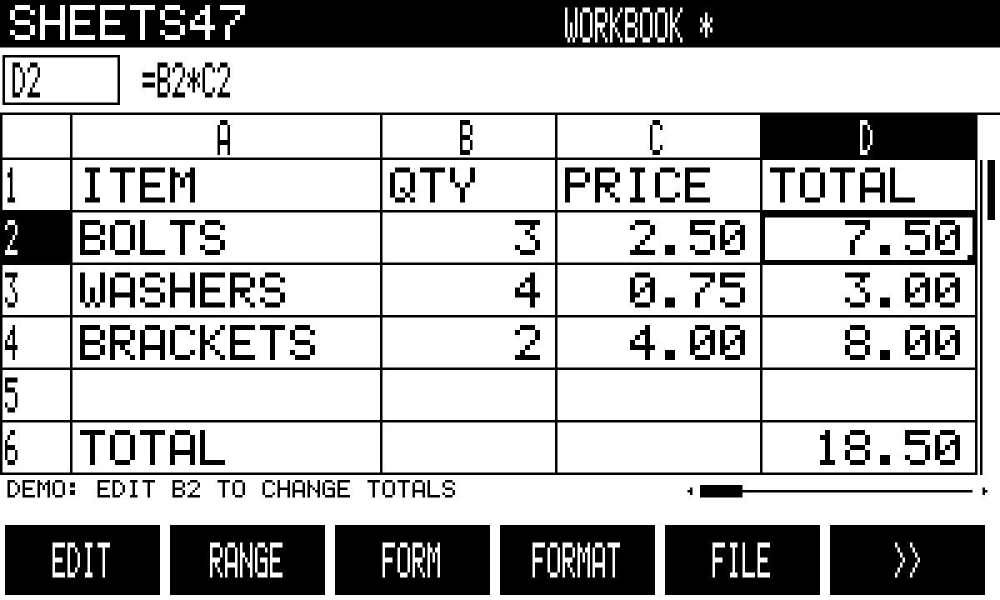
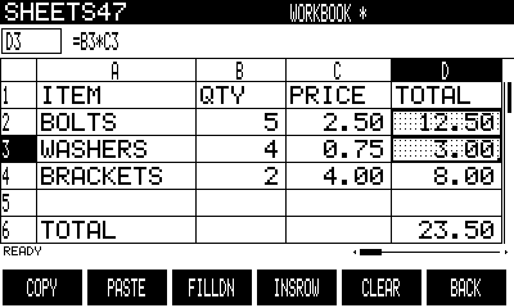
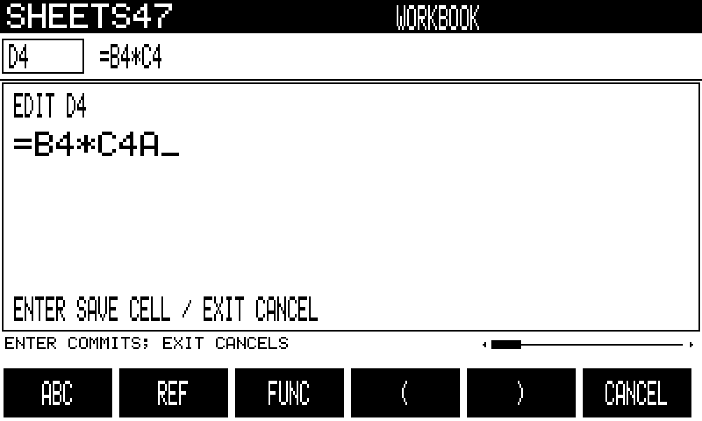

# Version 0.1.0 application output

These images come from the actual portable application, with the selected
Spreader backend, during host tests. They are no longer design drawings.
They do not demonstrate execution, font legibility, timing, or power behavior
on calculator hardware.

Native files are 400 × 240; `-3x` files enlarge pixels without interpolation.
Generate test PBM frames with `python3 -B tools/build.py host`, then run
`python3 -B tools/export_screenshots.py`. The optional host viewer runs these
same application commands and renderer interactively.
